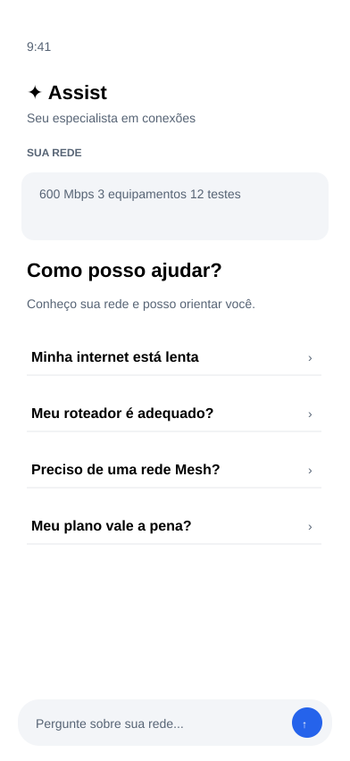
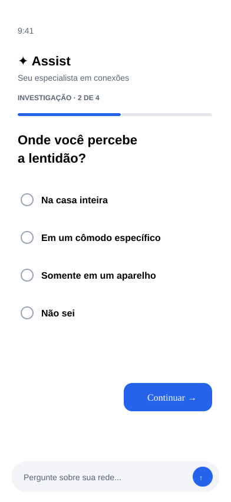
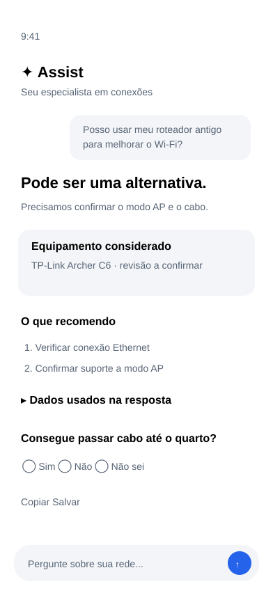

# Linka — Caderno visual de protótipos do Assist Contextual V4

**Referência de produto e UI/UX** · Fase 4 · Guardiã: **Priscila** (`priscila`).

Este documento reúne os quatro wireframes visuais registrados no repositório para o Assist Contextual V4. Os SVGs são referências estruturais de fluxo e hierarquia; a implementação em SwiftUI por **Bia** deve respeitar os tokens nativos do [`DesignSystem.swift`](../../aplicativo-ios/LinkaApp/Sources/UI/DesignSystem.swift) e os estados descritos em [`PRODUTO.md`](../PRODUTO.md#assist-contextual-v4).

## 1. Entrada do Assist e pergunta aberta

- Pergunta aberta sempre acessível; quatro jornadas guiadas como atalhos.
- [Issue #312](https://github.com/gmmattey/linka/issues/312) · [Issue #319](https://github.com/gmmattey/linka/issues/319)

## 2. Investigação guiada

- Pergunta progressiva, opções selecionáveis, 'Não sei', voltar/continuar e texto livre.
- [Issue #312](https://github.com/gmmattey/linka/issues/312) · [Issue #320](https://github.com/gmmattey/linka/issues/320)

## 3. Resposta contextual

- Conclusão direta, justificativa, equipamento/plano/medição quando pertinente, evidências recolhíveis, orientação, pergunta complementar, copiar/salvar.
- [Issue #312](https://github.com/gmmattey/linka/issues/312) · [Issue #319](https://github.com/gmmattey/linka/issues/319) · [Issue #317](https://github.com/gmmattey/linka/issues/317)

## 4. Oportunidades de melhoria → Assist

- Medição → oportunidade determinística → investigar com Assist → ação → reteste.
- [Issue #321](https://github.com/gmmattey/linka/issues/321)

## Regras transversais

SwiftUI nativo, identidade Linka, listas compactas, um CTA primário, Dynamic Type, VoiceOver, claro/escuro, dados com procedência, estados offline/erro/carregamento, consentimento contextual e zero conclusão inventada.
